# SaaS Subscription Revenue Analysis

Revenue analytics for a B2B SaaS company at its Q3 2026 close: a documented MRR / ARR / NRR / GRR metric layer in SQL, why expansion slowed, who is quietly downgrading, and what Customer Success, Sales, Product and Marketing should do about it — with the expected NRR impact of each play.

> **The data is synthetic, on purpose.** Public SaaS billing data with plan changes, seat changes, invoices and product usage does not exist, and real company data cannot be shared. So I designed the data model first, wrote down the business rules ([`docs/data_model.md`](docs/data_model.md)), and generated 36 months of data for ~5,300 accounts from those rules (fixed seed, fully reproducible). Six business events were planted on purpose, which gives the analysis an answer key: the [validation table](docs/03_data_quality_checks.md) shows the method recovered five of them, and the sixth (seasonality) is, as designed, not separable with two years of history. The numbers describe a fictional company; the metric definitions, SQL, decomposition method and plays are what transfer.

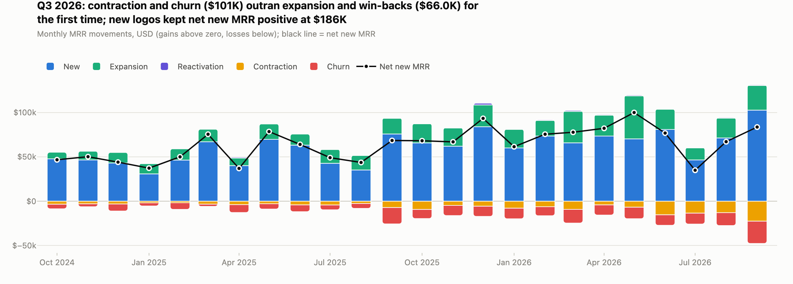

| ARR (30 Sep 2026) | 12-month NRR | 12-month GRR | Q3 run-rate NRR | Q3 expansion rate |
|---|---|---|---|---|
| **$24.8M** (+76% YoY) | **103.5%** (107.0% in June) | **84.6%** | **92.9%** (103.6% a year ago) | **3.4%** of starting MRR (4.9% a year ago) |

**Three things to know**

1. **NRR flatters the trend.** 103.5% includes a one-off company-wide rollout at one customer; without it NRR is 101.0%, and Q3 alone annualises to 92.9%. If Q4 looks like Q3, the 12-month figure keeps falling.
2. **Expansion slowed for two structural reasons, not just a hangover from a big Q2.** The one-off explains most of the 33% dollar drop from Q2, but like-for-like expansion fell from 4.9% to 3.4% of starting MRR year over year — past the 1-point line the VP set for a re-forecast. Against Q3 2025: Technology accounts −$22.3K MRR (fewer seat adds, more seat cuts — consistent with the hiring freezes CSMs report), Basic → Premium upgrades −$15.6K (the monthly upgrade rate halved, 1.51% → 0.69%, after the April packaging change; the Paid Social mix shift explains only 4% of it).
3. **324 accounts are quietly downgrading** — paying ≥ 20% less than six months ago without cancelling: $1.07M ARR still on the books (4.3% of ARR), $649K already lost, 60% of them Technology. Their past cuts don't predict more loss; low seat utilization does (flagged accounts shrink or leave 2.3× as often as the average account, a median 4 months later). That signal ranks the CS list.

## The request

> *"The board wants to see NRR. Expansion clearly slowed last quarter — why? Which customers are quietly downgrading? Which accounts should the CS team prioritize?"* — VP of Revenue

Clarified into six questions with the decision each one feeds ([`docs/01_request_and_scope.md`](docs/01_request_and_scope.md)): the VP re-forecasts expansion if the like-for-like Q3 rate is ≥ 1 point below Q3 2025 (it is: −1.5 points); the Head of CS staffs CSM-led reviews if the top 120 accounts hold ≥ 60% of the revenue at stake (they hold 66%).

## Recommendations

Seven plays, each with an owner, a target list that exists today, a control group and stated risks. Each play's size = measured addressable MRR × measured historical loss (or upgrade) rate × an **assumed** effect with a low–high range; every account counts in one play only ([`notebooks/05_recommendations.ipynb`](notebooks/05_recommendations.ipynb)).

| # | Play | Owner | Next year's NRR | How we will know |
|---|---|---|---|---|
| P1 | CSM renewal desk for the top 120 at-risk accounts (renewals first) | Head of CS | +0.56 pts | 1-in-5 random holdout; 6- and 12-month GRR |
| P7 | Payment-failure recovery: retries, card updater (66% of failed charges recover today) | Billing Ops / RevOps | +0.30 pts | A/B on the retry schedule |
| P3 | Flexible seat bands for Technology annual renewals | Sales + CS | +0.26 pts | Offer in alternate renewal months |
| P2 | Digital re-engagement for the rest of the risk list (798 accounts) | Lifecycle Marketing | +0.16 pts | 50/50 by account |
| P5 | Test a capped Basic package on new signups before reverting | Product / Pricing | +0.12 pts (≈ +0.7 pts a year once rolled out) | 50/50 test, decision read Jul 2027 |
| P4 | Premium trial for the top 100 upgrade candidates each quarter | Sales-assist | +0.09 pts | 30% holdout |
| P6 | Activation + annual offer for Paid Social cohorts | Growth Marketing | +0.04 pts (most value after next year) | Alternate signup weeks |
| | **Total** | | **≈ +1.5 pts** (range +0.8 to +2.4) | |

The CS team works from [`docs/account_health_list.csv`](docs/account_health_list.csv): 1,289 accounts with queue, priority, reason codes, evidence in plain words, ARR at stake and the play. The board memo is [`docs/readout.md`](docs/readout.md); the recurring monthly review is [`docs/monthly_revenue_review.md`](docs/monthly_revenue_review.md).

## Key charts

| | |
|---|---|
| 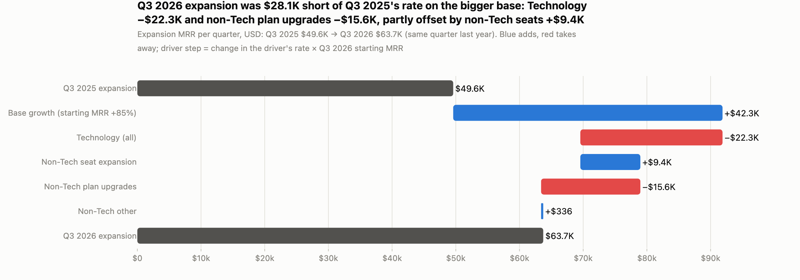 | 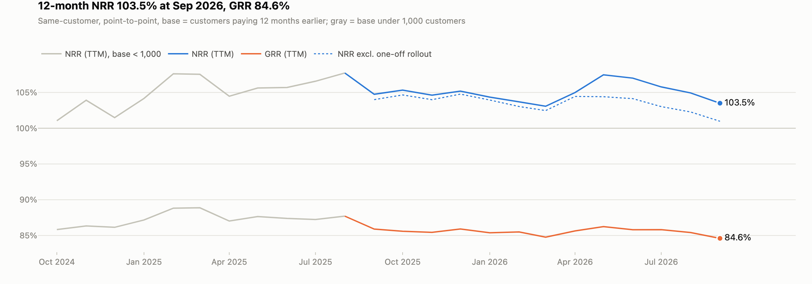 |
| **Expansion bridge vs Q3 2025:** a bigger base adds $42K; Technology and Basic upgrades take away $38K | **NRR / GRR:** June's peak is the one-off; the dotted line removes it |
| 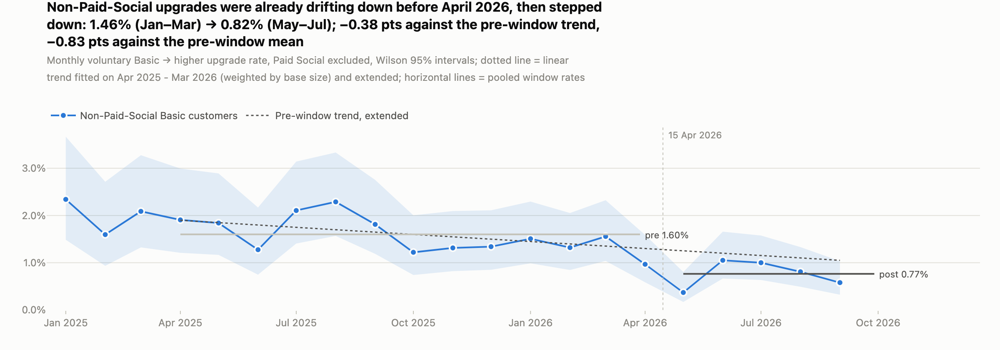 | 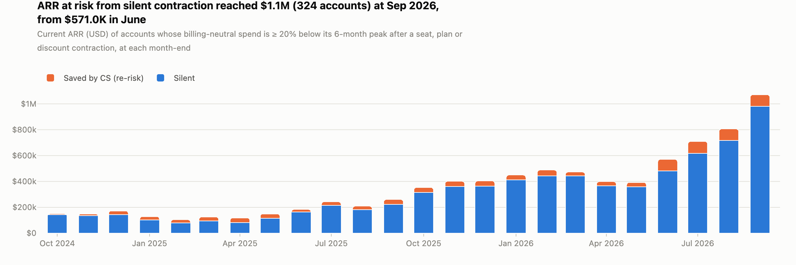 |
| **Basic → Premium upgrades:** a step down after April on top of an earlier drift | **ARR at risk from silent contraction** quadrupled in a year |
| 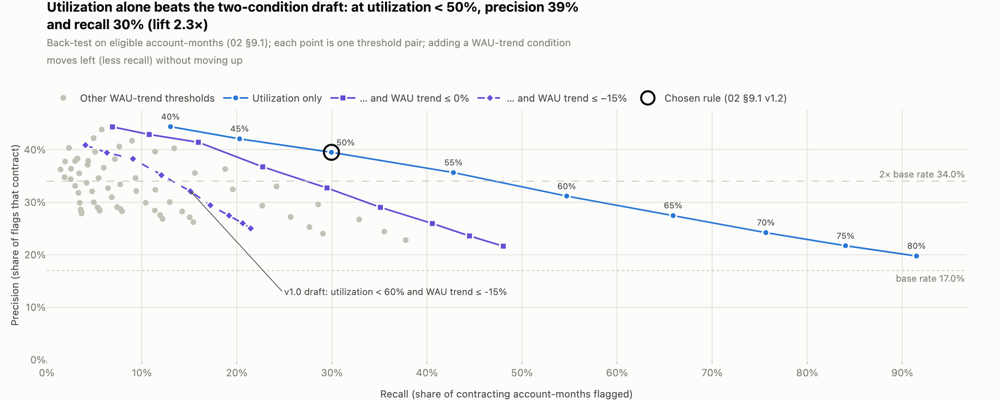 | 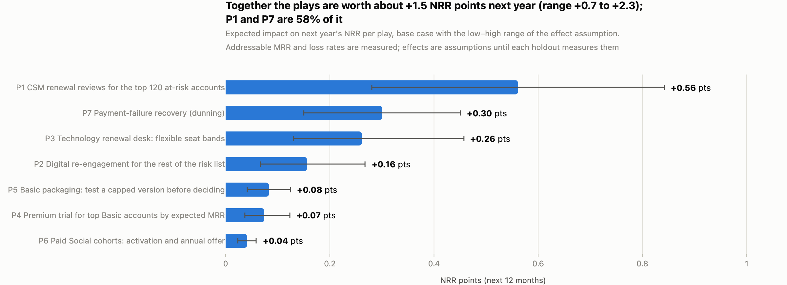 |
| **Early-warning rule:** utilization alone beats the two-condition draft | **Plays:** expected NRR impact with the range of the effect assumption |

More: [cohort NRR heatmap](reports/figures/cohort_nrr.png) · [plan-transition Sankey](reports/figures/plan_sankey.png) · [upgrade signals](reports/figures/expansion_signals_smd.png) · [QoQ bridge](reports/figures/expansion_bridge_qoq.png). The full write-up with interactive charts is one self-contained file: [`reports/report.html`](reports/report.html) (download and double-click; no server needed).

## Dashboard (Streamlit, 8 pages)

Every page opens with the one question it answers and ends with "How to read this". Filters on the MRR Waterfall, NRR / GRR Cohorts, Plan Transitions, Expansion Signals, Silent Churn and Recommendations pages change the calculation, not just the view (e.g. the silent-churn threshold, the early-warning rule, the reach and effect of each play).

| | |
|---|---|
| 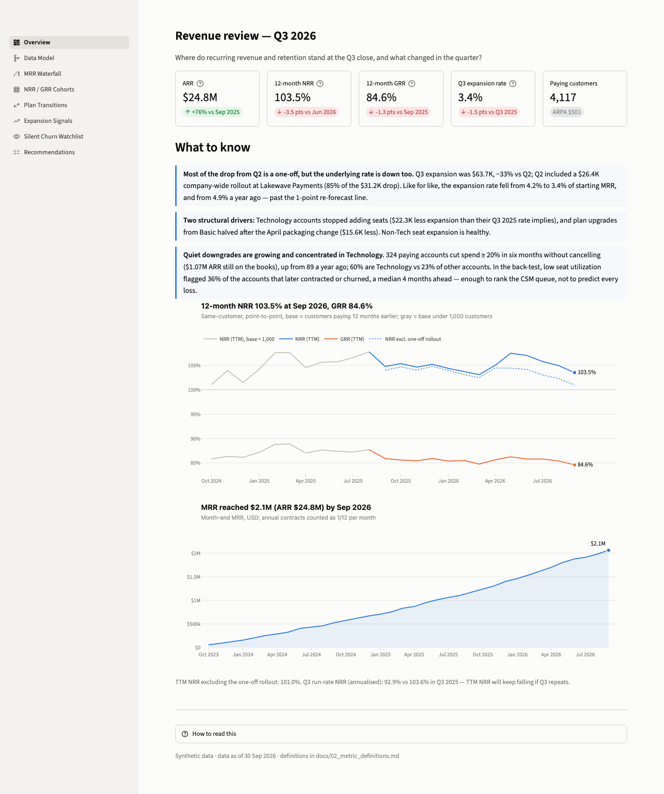 **1. Overview** — board numbers and the three things to know | 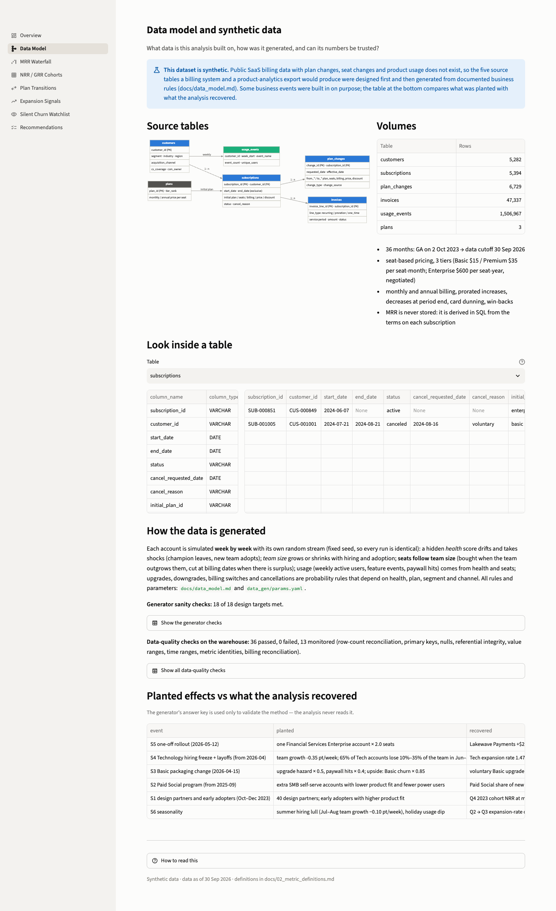 **2. Data Model** — tables, generation rules, data-quality and known-answer checks |
| 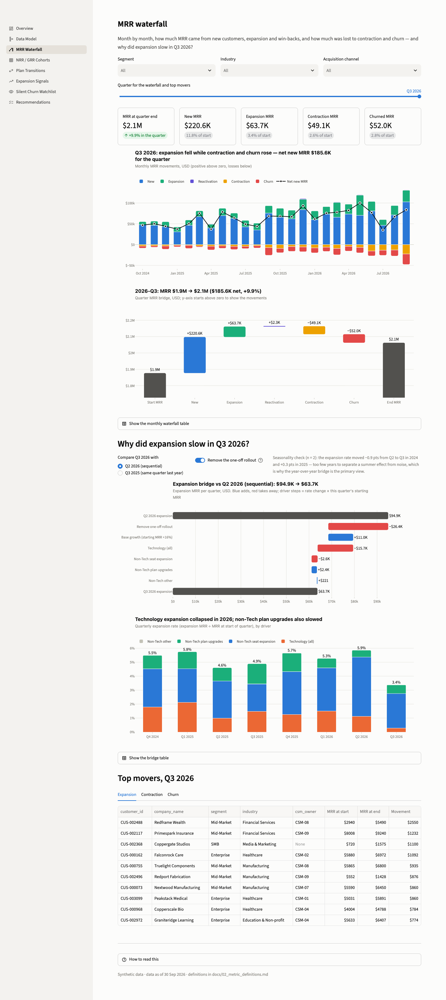 **3. MRR Waterfall** — monthly / quarterly movements and the expansion bridges | 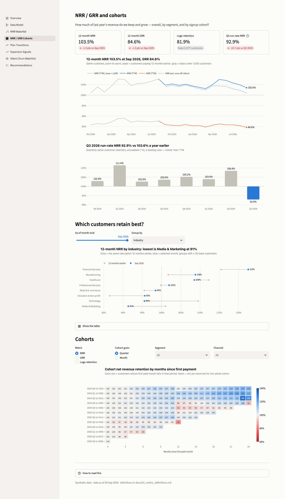 **4. NRR / GRR Cohorts** — retention by segment and signup cohort |
| 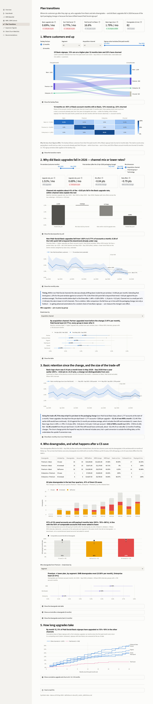 **5. Plan Transitions** — Sankey, upgrade rate before / after, mix vs rate, downgrades | 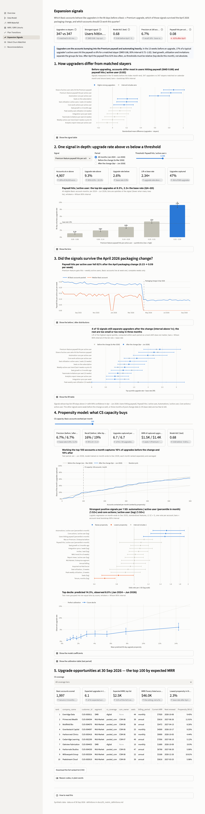 **6. Expansion Signals** — what precedes an upgrade, model, opportunity list |
| 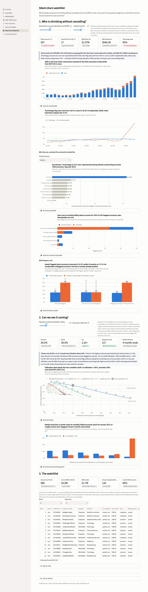 **7. Silent Churn Watchlist** — who is shrinking, early-warning back-test, CS list | 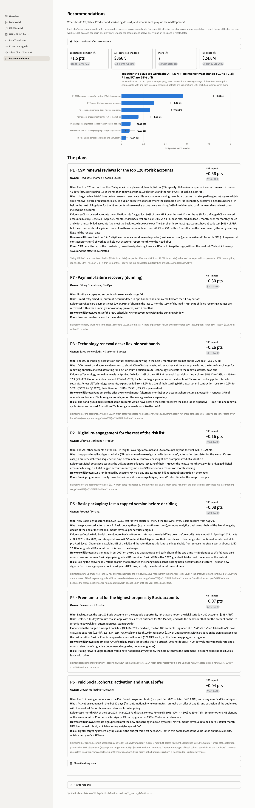 **8. Recommendations** — plays with adjustable assumptions |

## Method and data

- **Data model** ([`docs/data_model.md`](docs/data_model.md)): `customers`, `subscriptions`, `plan_changes`, `invoices`, `usage_events` (+ `plans`), the shape a Stripe / Chargebee billing export and a product-analytics export would have. MRR is never stored; it is derived from subscription terms. Each account is simulated week by week: a hidden health score, team size that drives seats, usage that follows health and seats, and probability rules for upgrades, downgrades, billing switches, renewals, dunning and win-backs. 18 design-target checks pass ([`data_gen/sanity_checks.py`](data_gen/sanity_checks.py)).
- **Metric layer** ([`sql/`](sql), DuckDB, dbt-style `stg → int → fct → rpt`): 23 models, each runnable on its own. MRR month-end snapshots (annual ÷ 12, net of discounts), customer-level movements (new / expansion / contraction / churn / reactivation, identity exact to the cent), each change split into plan → seats → billing period → discount, point-to-point TTM NRR / GRR, quarterly run-rate NRR, cohorts with right-censoring, silent contraction on billing-neutral MRR (annual list price is exactly 80% of monthly, so a billing switch alone never counts). Definitions: [`docs/02_metric_definitions.md`](docs/02_metric_definitions.md).
- **Checks** ([`docs/03_data_quality_checks.md`](docs/03_data_quality_checks.md)): 49 data-quality checks (36 pass, 13 monitored, 0 fail); invoices reconcile with daily MRR within 0.1% a year; an independent Python re-implementation written from the definitions alone matches the SQL on 16 of 16 comparisons; known-answer tests recover 5 of 6 planted events (the sixth, seasonality, is not separable with two years — as expected).
- **Analyses** ([`notebooks/`](notebooks), [`src/saas_rev/analysis/`](src/saas_rev/analysis)): 01 metrics and expansion bridges (QoQ and YoY, one-off removed first, non-overlapping driver buckets) · 02 plan transitions (mix vs rate decomposition, step vs pre-existing drift, Wilson / Newcombe intervals) · 03 upgrade signals (upgraders vs calendar- and tenure-matched stayers, time-split logistic model, no tuning) · 04 silent churn (definition, profile, 6-month follow-up vs matched accounts, early-warning back-test with an operating point chosen by a rule fixed in advance) · 05 recommendations.
- **Assumptions** are logged one per line in [`docs/assumptions.md`](docs/assumptions.md).

## Limitations

- **Synthetic data:** effect sizes come from rules I wrote; findings describe this dataset only. The generator was calibrated until the VP's premise held, which is disclosed in the data model.
- **Observational, not causal:** the packaging and Technology findings line up in time with known events; a pre-existing drift means the packaging effect is a range (the monthly Basic upgrade rate fell 0.4 to 0.8 points because of it, not a single number). The proposed tests are the clean answer.
- **Small samples where flagged:** 73 post-change upgrades, 43 CS saves with follow-up, two prior years for seasonality — intervals are shown.
- **Play effects are assumptions** until each holdout reads out; plan on the low end.
- **What I would want next:** sales pipeline data for sales-assisted expansion, CRM notes and headcount signals for Technology accounts, user-level product events, and trial data to measure the packaging change's conversion goal.

## How to run

```bash
uv sync                                  # Python 3.12 environment from uv.lock (or: pip install -r requirements.txt)
make all                                 # generate data → SQL warehouse → analyses → notebooks → report → docs (~2 min)
uv run streamlit run dashboard/app.py    # the dashboard
```

Data is written outside the repo, to `data_dir` in [`config.yaml`](config.yaml) (default `~/projects/data-projects/datasets/p5-saas-synthetic`); override with `SAAS_DATA_DIR=/some/path make all` or a `.env` file ([`.env.example`](.env.example)). Nothing generated is committed except the reports, figures and documents. Single steps: `uv run python run.py warehouse marts report`; one SQL file on its own: `uv run python -m saas_rev.warehouse --file sql/25_rpt_nrr_grr_ttm.sql` (all of them: `--check-standalone`); tests: `make test`.

```
sql/            metric layer (00 load → 91 data-quality checks)
src/saas_rev/   warehouse runner, analysis modules, charts, cross-check, validation, report and doc builders
data_gen/       synthetic data generator, parameters, sanity checks
notebooks/      01–05, executed; HTML exports in reports/
dashboard/      Streamlit app (app.py + views/)
docs/           scope, definitions, data model, data quality, assumptions, readout, monthly review, CS list
reports/        report.html, notebook HTML, figures, screenshots, key_numbers/*.json
```

## Where the numbers come from

Every number in this README, the readout and the dashboard is read from `reports/key_numbers/*.json`, written by the pipeline from the SQL marts.

| Number | Source |
|---|---|
| ARR, NRR, GRR, run-rate NRR, expansion rates, bridges, one-off | `metrics.json` ← `sql/23`–`25`, `analysis/metrics.py`, notebook 01 |
| Basic upgrade rates, mix share, net packaging effect | `transitions.json` ← `sql/24`, `analysis/transitions.py`, notebook 02 |
| Upgrade signals, model, opportunity list | `expansion.json` ← `sql/41`, `analysis/expansion.py`, notebook 03 |
| Silent contraction, early-warning rule, CS list | `silent_churn.json` ← `sql/50`, `sql/41`, `analysis/silent_churn.py`, notebook 04 |
| Play sizes, NRR base, CS trigger, dunning recovery | `recommendations.json` ← `analysis/recommendations.py`, notebook 05 |
| Data-quality, cross-check, known-answer results | `sql/91`, `reports/crosscheck_results.json`, `answer_key.json` |
