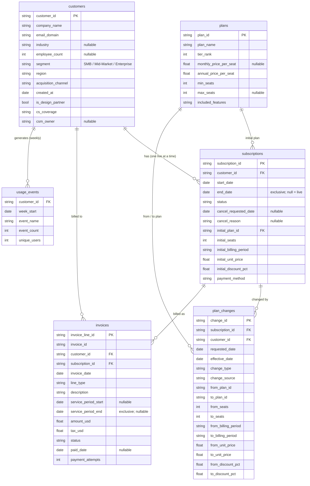

# Data model and synthetic data generation (generator v1.1)

> **This dataset is synthetic.** Public, row-level SaaS billing data with plan changes, seat changes and product usage does not exist (the commonly used IBM Telco churn file has one row per customer, no upgrade / downgrade events and no usage). So I designed the data model a billing system (Stripe / Chargebee style) plus a product-analytics export would produce, and generated 36 months of history from documented business rules. Every rule and parameter is below; the code is `data_gen/generate.py` (version 1.1), parameters are in `data_gen/params.yaml` (source of truth if this page and the file ever disagree), the calibration history is in §9, and the planted effects are listed in §6 as an answer key that is used only to validate the method. Seed `20261103` (`config.yaml`); two runs produce identical files. Published run: `_manifest.json` in the raw data folder (params SHA-256 `960e78bd…`).

## 1. Business being modeled

A fictional B2B SaaS company selling a **team workflow-automation platform**, priced **per seat** in three tiers. General availability (GA) was **2 Oct 2023** (a Monday); data is complete through **30 Sep 2026** (the Q3 2026 close). Customers are companies ("accounts"); each account has at most one live subscription at a time.

| Plan | Tier | Monthly price / seat | Annual price / seat / year (= per month) | Seats | What it adds |
|---|---|---|---|---|---|
| Basic | 1 | $15 | $144 ($12.00) | 1 – 50 | Core workflows, 5 integrations, simple automations |
| Premium | 2 | $35 | $336 ($28.00) | 3+ | Advanced automations*, analytics dashboards, API, unlimited integrations |
| Enterprise | 3 | annual only | $600 list ($50.00), negotiated discount 10–30% | 50+ | SSO / SCIM, audit log, sandbox, named CSM, SLA |

\* From 15 Apr 2026, advanced automations are included in Basic (packaging change, §6 S3).

**Billing and change policies (as in most self-serve + sales-assisted SaaS):**
- Monthly plans bill on the subscription anniversary day (anniversaries on the 29th–31st bill on the last day of shorter months); annual plans bill 12 months upfront. Annual list price is exactly 80% of monthly list price per seat.
- **Increases are immediate** (seat adds, upgrades) and invoiced as a **prorated** line for the rest of the current period; annual seat adds are co-termed to the annual term.
- **Decreases take effect at the end of the current period** (next monthly billing date, or the annual renewal date). No mid-term refunds.
- Monthly → annual switches take effect at the next billing date and start a new 12-month term from that date; annual → monthly switches happen only at renewal.
- Cancellations take effect at the end of the paid period (voluntary) or 14 days after a failed card charge (dunning window).
- Card-paid accounts are charged on the billing date (the first charge is taken at checkout and never fails). Invoice-paid accounts pay 5–45 days after the invoice date; lines not yet paid at the cutoff are `open`.
- Up to 10% more weekly active users than purchased seats is **tolerated, never billed** (there are no true-ups).
- Enterprise and sales-led Mid-Market deals can carry a one-time onboarding fee (not recurring revenue).
- Deliberately not modeled: multi-year contracts, list-price increases, seat true-ups, FX, credit notes and refunds.

## 2. Entity-relationship diagram

## 3. Tables and fields

Grain, keys and volumes are checked in `docs/03_data_quality_checks.md`. Row counts below are from `_manifest.json` of the published run. All six tables are parquet; dates are `DATE`, money is USD, `discount_pct` is a fraction in [0, 1] (0.15 = 15%) in every table.

### `plans` — plan catalog (3 rows)
| Field | Type | Description |
|---|---|---|
| `plan_id` | string, PK | `basic`, `premium`, `enterprise` |
| `plan_name` | string | Display name |
| `tier_rank` | int | 1 = Basic, 2 = Premium, 3 = Enterprise. A change to a higher rank is an upgrade. |
| `monthly_price_per_seat` | float, nullable | List price per seat per month (USD); null for Enterprise (annual only) |
| `annual_price_per_seat` | float | List price per seat per year (USD) |
| `min_seats` / `max_seats` | int, `max_seats` nullable | Seat limits; `max_seats` null = unlimited |
| `included_features` | string | Short feature summary |

### `customers` — one row per CRM account record (≈ 5,300; 5,282)
5,260 real accounts that have paid at least once, 6 internal / test accounts and 16 duplicate CRM records (§7).

| Field | Type | Description |
|---|---|---|
| `customer_id` | string, PK | `CUS-000001`, assigned in signup order (duplicate CRM records come last) |
| `company_name` | string | Generated name (fictional); internal accounts use test-style names (§7) |
| `email_domain` | string | Billing contact domain (`<companyname>.example`). Internal / test accounts use `ourcompany.example`. |
| `industry` | string, nullable | 8 industries; null for ≈ 2% of self-serve SMB signups (not asked at signup) |
| `employee_count` | int, nullable | Company size as currently held in the CRM; null for ≈ 3%; ≈ 3% sit outside their segment band (§7) |
| `segment` | string | `SMB` (≤ 100 employees), `Mid-Market` (101–1,000), `Enterprise` (1,000+). Set by Sales Ops at signup; static; the system of record for segment cuts. |
| `region` | string | North America / EMEA / APAC |
| `acquisition_channel` | string | Organic, Paid Search, Paid Social, Partner, Outbound Sales, Events |
| `created_at` | date | Account created (trial start for self-serve, 3–30 days before the first paid day; first meeting for sales-led, 20–90 days before) |
| `is_design_partner` | bool | Private-beta design partner converted at GA (40 accounts) |
| `cs_coverage` | string | `digital` (SMB, tech-touch), `pooled_csm` (Mid-Market), `named_csm` (Enterprise) |
| `csm_owner` | string, nullable | CSM book code: `CSM-01`…`CSM-04` named (Enterprise), `CSM-05`…`CSM-10` pooled (Mid-Market); null for digital coverage |

### `subscriptions` — one row per subscription (≈ 5,400; 5,394)
A win-back creates a new subscription (128 in the published run), so accounts can have more than one row, never overlapping.

| Field | Type | Description |
|---|---|---|
| `subscription_id` | string, PK | `SUB-000001`, assigned in start-date order |
| `customer_id` | string, FK | Owning account |
| `start_date` | date | First day of service (first paid day) |
| `end_date` | date, nullable | **Exclusive** end of service: the subscription is live on days `[start_date, end_date)`. Null = live at the cutoff. |
| `status` | string | As of 2026-09-30: `active` (live), `past_due` (live, card charge failed and the 14-day dunning window had not ended at the cutoff), `canceled` |
| `cancel_requested_date` | date, nullable | When the customer asked to cancel (voluntary: 1–20 days before a monthly billing date, 15–60 days before an annual renewal) or the date of the failed charge that started dunning (payment failure) |
| `cancel_reason` | string, nullable | `voluntary` or `payment_failed` |
| `initial_plan_id`, `initial_seats`, `initial_billing_period`, `initial_unit_price`, `initial_discount_pct` | | Terms at start. `unit_price` is the list price per seat **per billing period** (monthly: per month; annual: per year); `initial_billing_period` is `monthly` or `annual`. Later terms come from `plan_changes`. |
| `payment_method` | string | Method at subscription start: `card` (self-serve monthly) or `invoice` (annual / sales-led) |

### `plan_changes` — one row per change to a live subscription (≈ 6,700; 6,731 incl. 13 orphan rows, §7)
| Field | Type | Description |
|---|---|---|
| `change_id` | string, PK | `CHG-0000001`, assigned in effective-date order |
| `subscription_id`, `customer_id` | string, FK | |
| `requested_date` | date | When the change was requested (= `effective_date` for immediate changes; 1–20 days earlier for monthly-boundary changes, 15–45 days earlier for renewal changes, the agreement date for Premium → Enterprise upgrades) |
| `effective_date` | date | When the new terms apply (a business day for immediate increases; the billing date for decreases, switches and renewal changes). The generator writes no row with `effective_date ≥ end_date` except the injected orphan rows. |
| `change_type` | string | Primary type, by precedence: `upgrade` / `downgrade` (tier changed) → `seat_increase` / `seat_decrease` → `billing_period_change` → `discount_change`. Published run: 4,246 / 1,465 / 555 / 144 / 300 / 21. |
| `change_source` | string | Who initiated the change (values below) |
| `from_*` / `to_*` | | Plan, seats, billing period, unit price and discount before and after. `from_*` is the state at `effective_date`, so rows chain: the first row's `from_*` equals the subscription's `initial_*` and each row's `from_*` equals the previous row's `to_*` (checked in `sql/91_dq_checks.sql`). A single row can change several attributes (e.g., a renewal that downgrades and removes seats). |

`change_source` values as the generator writes them:

| Value | Written for |
|---|---|
| `self_serve` | Changes an SMB-segment account makes in the billing portal: seat additions, Basic → Premium upgrades, and the decreases / monthly → annual switches applied at its monthly billing date. Also the 13 injected orphan rows. |
| `sales` | Sales-assisted changes: seat additions and Basic → Premium upgrades on Mid-Market / Enterprise-segment accounts, every Premium → Enterprise upgrade, and the S5 rollout. |
| `customer_success` | CS-negotiated saves (§5.4: downgrade-to-save, retention discount, Enterprise → Premium save). **Known labelling issue in v1.1:** the generator also writes `customer_success` for the ordinary decreases / switches applied at a *monthly* billing date on Mid-Market / Enterprise-segment accounts (the pooled or named CSM keys them in; `generate.py`, `monthly_boundary`). 421 of the 449 `customer_success` rows are Mid-Market, so this value cannot be read as "save" on its own; `02_metric_definitions.md §9` treats it as a save. |
| `renewal` | Changes applied at an annual renewal: seat right-sizing, Enterprise → Premium and Premium → Basic downgrades, annual → monthly switches, price concessions / uplifts (one combined row). |
| `system` | Seat-cap (forced) upgrades: a Basic account asked for more than 50 seats and was moved to Premium (10 rows). |

Renewals with unchanged terms produce no row. MRR is **not** stored anywhere in the source data; it is derived in `sql/` from these terms (see `02_metric_definitions.md §3`).

### `invoices` — one row per invoice line (≈ 47,000 lines; 47,339 lines on ≈ 47,100 invoices)
| Field | Type | Description |
|---|---|---|
| `invoice_line_id` | string, PK | `INV-0000001-1` (`<invoice_id>-<line_no>`) |
| `invoice_id` | string | Invoice header id. Recurring and one-time lines of one customer on one day share an invoice; each proration is its own invoice; voided duplicates use `INV-V000001`. |
| `customer_id`, `subscription_id` | string, FK | |
| `invoice_date` | date | Issue date (billing date for recurring lines; change date for prorations) |
| `line_type` | string | `recurring` (period charge, 42,316), `proration` (mid-period increase, 4,788), `one_time` (onboarding fee, 235) |
| `description` | string | Human-readable line text, e.g. `Premium x 12 seats (monthly)`, `Proration: basic x10 -> premium x10`, `Onboarding & implementation` |
| `service_period_start` / `service_period_end` | date, nullable | Service period covered (`end` exclusive): the billing period for recurring lines, change date → period end for prorations; null for one-time lines |
| `amount_usd` | float | Pre-tax, after discount |
| `tax_usd` | float | Sales tax / VAT (North America 7.25%, 40% of accounts exempt; EMEA 20%; APAC 10%) — excluded from all revenue metrics |
| `status` | string | `paid`; `open` (invoice-terms payment, or a card retry, not yet received at the cutoff: 815 lines); `uncollectible` (card renewal failed and was never recovered: 195); `void` (issued in error: 273 = 236 injected duplicates + 37 lines of internal accounts, which are never charged) |
| `paid_date` | date, nullable | Card: same day, or 1–14 days later after a successful retry; invoice: 5–45 days after `invoice_date` |
| `payment_attempts` | int | 1 normally; 2–4 when a card retry succeeded; 4 for `uncollectible`; 0 for voided duplicates |

### `usage_events` — account × week × event (≈ 1.5 million rows; 1,506,998 incl. ≈ 6,000 duplicates)
Weekly aggregates exported from the product-analytics tool. Weeks start on Monday (first week 2 Oct 2023, last week 28 Sep 2026 with 3 days). One row per (`customer_id`, `week_start`, `event_name`) with `event_count` > 0; 7 event types.

| `event_name` | Meaning | `unique_users` |
|---|---|---|
| `session` | Product sessions | **Weekly active users (WAU)** — users with ≥ 1 session |
| `core_action` | Work items created / updated | Users doing it |
| `automation_run` | Automation executions | Users who built / triggered one |
| `report_view` | Analytics dashboard views | Users viewing |
| `integration_sync` | Integration sync jobs (service accounts) | 0 |
| `user_invite` | Invitations sent to new teammates | Admins sending (usually 1–2) |
| `premium_feature_gate` | A Basic user hit a Premium-only feature (paywall); Basic accounts only | Users who hit it |

## 4. How the data is generated — overview

1. **Acquire accounts** month by month (Poisson draws per segment × channel, with growth, seasonality and quarter-end effects), and draw each account's firmographics, initial terms and hidden traits (§5.1–5.3).
2. **Simulate each account week by week** from its first paid day to the cutoff (157 weekly steps at most), independently, with its own random stream (`numpy.random.SeedSequence(seed).spawn`), so results do not depend on processing order. Each week updates latent health and team size, may trigger an immediate change, and applies the billing-boundary logic (renewal, decreases, churn, charge) when a billing date falls in the week (§5.4).
3. **Write the source tables** (customers, subscriptions, plan changes, invoices) and build the **usage events** from the weekly state (§5.6).
4. **Inject data-quality issues** that a real pipeline has (§7), so the data-quality checks have something to catch.
5. **Run the 18 sanity checks** (`data_gen/sanity_checks.py`) against the targets in §8; results in `reports/generator_sanity_checks.json`.

The run writes `_manifest.json` (version, seed, parameter hash, row counts, ≈ 7 s run time) and `_scenario_truth.json` (the planted-effects answer key: scenario parameters, the rollout account id, the injected internal / duplicate ids and injection counts). The analysis never reads the truth file; it is used only by the known-answer tests.

## 5. Generation rules

Notation: `U(a, b)` uniform draw, `N(m, s)` normal, `pt` = percentage point per week (0.12 pt = 0.0012 / week), `sigmoid(x) = 1 / (1 + e^{−x})`, `N` team size, `N̄` team size averaged over the last 4 weeks, `H` latent health, `μ` latent fit.

### 5.1 Acquisition (new accounts)
- Expected new accounts in month *m* (0 = Oct 2023): `88 × 1.022^m × season(month) × segment share × channel share`, Poisson-drawn per segment × channel cell. Sales-led channels (Partner, Outbound Sales, Events) get ×1.30 in quarter-end months (Mar / Jun / Sep / Dec) and ×0.85 in quarter-start months (Jan / Apr / Jul / Oct); half of the sales-led deals in a quarter-end month sign in its last 7 days, and sales-led deals sign on business days. Self-serve signups land on a uniform random day of the month.
- **S3 new-logo uplift:** from May 2026, SMB accounts from Organic, Paid Search and Paid Social ×1.10 (better trial → paid conversion after the packaging change).
- New-logo seasonality: Jan 1.00, Feb 1.00, Mar 1.08, Apr 0.98, May 1.00, Jun 1.05, Jul 0.85, Aug 0.85, Sep 1.05, Oct 1.05, Nov 1.05, Dec 0.95.
- Segment share: SMB 68.5%, Mid-Market 27%, Enterprise 4.5%.
- Channel share within segment:

| Channel | SMB | Mid-Market | Enterprise |
|---|---|---|---|
| Organic | 40% | 20% | 5% |
| Paid Search | 30% | 18% | 5% |
| Paid Social | 10% | 4% | 0% |
| Partner | 10% | 18% | 25% |
| Outbound Sales | 3% | 28% | 50% |
| Events | 7% | 12% | 15% |

- **Design partners (S1):** 40 extra accounts (60% SMB, 35% Mid-Market, 5% Enterprise), channel Organic, signed 2–15 Oct 2023, fit +0.30.
- **Early adopters (S1):** every other account acquired in Oct, Nov or Dec 2023 gets fit +0.25 (early adopters self-select).
- **Paid Social program (S2):** extra SMB Paid Social accounts on top of the shares above: Poisson(15) in Sep 2025, Poisson(25) in Oct 2025, Poisson(35) in every month from Nov 2025.
- Industry mix (SMB / Mid-Market / Enterprise, %): Technology 28 / 26 / 22, Professional Services 16 / 15 / 10, Financial Services 10 / 12 / 18, Retail & E-commerce 13 / 12 / 10, Healthcare 9 / 10 / 14, Manufacturing 8 / 10 / 14, Media & Marketing 10 / 8 / 5, Education & Non-profit 6 / 7 / 7.
- Region: North America 55%, EMEA 30%, APAC 15% (no behavioral differences by design — a deliberate null).
- Employee count (log-normal median / σ, clipped to the segment band): SMB 25 / 0.8 (2–100), Mid-Market 300 / 0.6 (101–1,000), Enterprise 3,000 / 0.8 (1,001–60,000).
- `created_at` = first paid day − U(3, 30) days (self-serve) or − U(20, 90) days (sales-led). CS coverage follows the segment (§3); CSM books are assigned at random within the tier.

### 5.2 Initial subscription
- **Seats** (log-normal median / σ / clip, drawn first): SMB 6 / 0.65 / 1–45 (Paid Social SMB median 4); Mid-Market 22 / 0.60 / 8–250; Enterprise 75 / 0.55 / 50–1,000.
- **Plan, conditional on seats** (`initial.plan_by_seats`; first band whose upper limit covers the seat count):

| Segment | Seats | Basic | Premium | Enterprise |
|---|---|---|---|---|
| SMB | 1–2 | 100% | — | — |
| SMB | 3–45 | 80% | 20% | — |
| Mid-Market | 8–39 | 50% | 50% | — |
| Mid-Market | 40–45 | 10% | 90% | — |
| Mid-Market | 46–49 | — | 100% | — |
| Mid-Market | 50+ | — | 65% | 35% |
| Enterprise segment | 50+ (always) | — | 40% | 60% |

  Seats are then clipped to the plan's limits, which never binds: no account starts on Basic with more than 45 seats, and no Enterprise plan starts below 50. Implied signup mix in the published run: Basic 69.2% / Premium 27.9% / Enterprise 2.9% (§8).
- **Billing period:** the Enterprise plan is always annual; otherwise annual with probability SMB 22% (Paid Social SMB 8%), Mid-Market 60%, Enterprise segment 95%. Published run: 33.0% annual at signup.
- **Discounts** (stored as fractions, whole percentages): Enterprise plan U(10%, 30%); sales-led annual Premium deals in the Mid-Market / Enterprise segments: 50% chance of U(5%, 15%); otherwise 0.
- **One-time onboarding fee** (invoice line `one_time` on the start date): Enterprise plan U($5,000, $20,000) rounded to $500; sales-led annual Mid-Market Premium: 30% chance of U($1,500, $3,000) rounded to $100.
- **Payment method:** `card` for monthly self-serve (Organic / Paid Search / Paid Social), `invoice` otherwise.
- The first period is invoiced on the start date; that charge never fails (taken at checkout).
- **Initial team size:** `N = seats × U(0.90, 1.05)`.

### 5.3 Latent account traits (not exported)
Each account draws three hidden traits that drive behavior:
- **Fit** `μ` (long-run health): `1.0 + channel adj + 0.30 (design partner) + 0.25 (early adopter) + N(0, 0.6)`. Channel adj: Organic 0, Paid Search −0.10, Paid Social −0.50, Partner +0.25, Outbound Sales 0, Events −0.05. The S5 rollout account is set to μ = 2.0.
- **Power-user propensity** `power`: `N(0, 1) + segment adj (SMB 0, Mid-Market +0.3, Enterprise +0.4) + channel adj (Paid Social −0.6)`. Drives demand for Premium features.
- **Growth propensity** `growth`: `N(0, 1) + industry adj (Technology +0.4, Media & Marketing +0.2, Manufacturing −0.2, Education & Non-profit −0.3)`.

### 5.4 Weekly dynamics
Each account-week draws 18 uniforms and 2 standard normals from the account's own stream. The S5 rollout account and the 6 internal accounts are "protected": no churn, no seat reductions, no team cuts, no card failures (internal accounts are additionally frozen: no growth, no changes).

**Health.** Target `μ_t = μ − 0.40 × freeze(t)` (Technology accounts; `freeze(t)` ramps linearly from 0 to 1 over the 8 weeks from 6 Apr 2026 and stays at 1) `+ 0.10` (Basic accounts with `power > 0`, from the week of 13 Apr 2026 — S3 upside) `− 0.30 × (1 − weeks since start ÷ 6)` during the first 6 weeks (onboarding: `H` starts 0.30 below fit and the gap closes linearly over 6 weeks). Shocks first: champion leaves (0.25% / week, `H − U(0.8, 1.6)`); new team adopts (SMB 0.15%, Mid-Market 0.30%, Enterprise 0.30% / week; `H + U(0.3, 0.8)` and 8 weeks of burst growth). Then `H ← H + 0.06 (μ_t − H) + 0.12 ε`. The rollout account's `H` is floored at 1.5.

**Team size** `N` (people who want access). Weekly growth `r` (in pt) = segment base (SMB 0.12, Mid-Market 0.26, Enterprise 0.30) + 0.20 × `growth` + adoption term **(asymmetric)**: 0.30 × (H − 1) when H ≥ 1, 0.60 × (H − 1) when H < 1 (unhealthy accounts shed users faster) + hiring seasonality (§5.5) − 0.35 × `freeze(t)` (Technology) + 1.0 for the 8 weeks after a new-team shock + noise N(0, 0.5 pt). `N ← max(1, N·e^r)`. Then discrete cuts: a reorg / budget cut with probability 0.25% / week, `N × (1 − U(0.15, 0.40))`; **S4 layoff wave:** 65% of Technology accounts take one cut `N × U(0.65, 0.90)` in a random week between 1 Jun and 31 Jul 2026. After **any** seat reduction (seat right-sizing, random small reduction, save), `N ← min(N, new seats)`: removed users lose access, so the seats are not re-bought.

**Engagement and WAU.** `engagement = sigmoid(0.3 + 0.9·H) × usage seasonality`; `capacity = min(N, 1.10 × seats)` (overage tolerance); WAU ~ Binomial(round(capacity), engagement × min(1, 0.4 + 0.6 × active days ÷ 7)). Seat decisions use `N̄` (mean `N` over the last 4 weeks), not WAU.

**Integrations.** Start at Poisson(0.8 / 2.3 / 3.8) for SMB / Mid-Market / Enterprise; +1 with probability 2% / week × `sigmoid(H)` while below the cap; otherwise −1 with probability 0.5% / week when H < 0.5. Cap 5 on Basic, 20 on Premium / Enterprise.

**Order within a week.** One "immediate" event day `d` is drawn as a random business day of the week (on or after the start date). If a billing date falls in the week and `d` is on or after it, the billing boundary is processed first; otherwise the immediate change first, then the boundary.

**Immediate changes** (`effective_date = requested_date = d`; at most one per week, in this order; prorated invoice for the rest of the current period, co-termed to the annual term):
1. **S5 rollout:** on 12 May 2026 the rollout account multiplies its seats by 2.6 (`change_source = sales`; team size raised to match).
2. **Seat additions:** if `N > 1.03 × seats`, with probability 35% (SMB) or 25% (Mid-Market, Enterprise; procurement friction) × `sigmoid(H)` × sales quarter factor for non-SMB accounts (×1.30 in Mar / Jun / Sep / Dec, ×0.85 in Jan / Apr / Jul / Oct, by the month of the week's Thursday); new seats = `max(seats + 1, ⌈N × U(1.00, 1.08)⌉)`; source `self_serve` (SMB) / `sales` (others). A Basic account whose target exceeds 50 seats is moved to Premium instead (**seat-cap upgrade**, source `system`).
3. **Basic → Premium upgrade:** weekly hazard `λ = 0.0025 × exp(0.9·power + 0.4·(H − 1)) × (2.5 if N grew > 10% over the last 13 weeks, else 1) × packaging factor` (1.00 before, **0.50 from the week of 13 Apr 2026** — S3); probability `1 − e^{−λ}`. Seats and billing unchanged; source `self_serve` (SMB) / `sales` (others).
4. **Premium → Enterprise (agreement):** Mid-Market / Enterprise-segment Premium accounts with ≥ 60 seats and H > 0.5, at any time if monthly-billed or within 84 days (12 weeks) of the term end if annual-billed: weekly hazard `0.0040 × exp(0.5·power) × sales quarter factor`. The agreement date is the `requested_date`; the change takes effect at the **next billing boundary** as one row (plan Enterprise, billing annual, discount U(10%, 25%), seats unchanged, source `sales`). A pending upgrade is discarded if the account churns first.

**Billing boundary** (monthly billing date or annual renewal). One draw sequence per subscription per boundary, in this order:
1. **Voluntary churn draw**, then, if churn, the **downgrade-to-save draw** (both below). Saved → exactly one change row (source `customer_success`). Not saved → no change rows, any pending upgrade is discarded, `end_date` = the billing date (exclusive; no further period is billed), `cancel_reason = voluntary`, `cancel_requested_date` = billing date − U(1, 20) days (monthly; not before the period start) or − U(15, 60) days (annual).
2. Otherwise **one combined change row** if anything changed: the pending Premium → Enterprise upgrade if there is one; else, at a *monthly* billing date, a seat reduction or random small reduction, a Premium → Basic downgrade and a monthly → annual switch can combine; at an *annual renewal*, a seat right-sizing, an Enterprise → Premium or Premium → Basic downgrade, an annual → monthly switch and a renewal price concession / uplift can combine. Source: `self_serve` (SMB) or `customer_success` (Mid-Market / Enterprise segment — see the labelling note in §3) at a monthly date; `renewal` at a renewal. `requested_date` = billing date − U(1, 20) days (monthly; = billing date for a switch to annual) or − U(15, 45) days (renewal).
3. **The recurring charge** for the next period (invoice dated the billing date), then the card-failure draw and, if it fails and is not recovered, the 14-day dunning window (below). No other change is drawn while in dunning.

**Seat reductions** (at a boundary): at a monthly billing date, if `seats > 1.15 × N̄`, with probability 30% (× `(1 + 0.5 × freeze(t))` for Technology accounts, i.e. up to 45%); at an annual renewal, if `seats > 1.10 × N̄`, with probability 65% (× up to 1.5, capped at 95%). New seats = `max(1, ⌈N̄ × U(1.00, 1.10)⌉)`, then clipped to the plan minimum. Otherwise, at a monthly billing date only, a **random small reduction** with probability 1% if the account has more than 2 seats: `seats − max(1, round(5% of seats))` (someone left).

**Downgrades** (at a boundary, discount reset to 0): Premium → Basic at a monthly billing date with probability `0.6% × exp(−0.8·(H − 1)) × exp(−0.5·power)`, only if the (right-sized) seat count is ≤ 50; ×6 at an annual renewal. Enterprise → Premium at renewal: with probability 50% if the right-sized seat count fell below 50; otherwise `6% × exp(−0.8·(H − 1))`.

**Billing switches:** monthly → annual at a monthly billing date with probability 2% (SMB 1.5%) if tenure ≥ 3 months and H > 0.8; the anniversary day moves to the switch date and Mid-Market / Enterprise-segment accounts move to invoice billing. Annual → monthly at renewal with probability 20% if H < 0.3 (never for the Enterprise plan). Because annual list is 80% of monthly list, a switch to annual **lowers** MRR (counted as contraction in its own component — `02_metric_definitions.md §4.1`).

**Renewal price changes** (annual renewals of Enterprise-plan accounts and of any discounted account): H < 0.5 → 40% chance of an extra U(3, 10) pts of discount (concession, capped at 40%); H > 1.5 and discount > 0 → 20% chance the discount is reduced by U(2, 5) pts (uplift, floored at 0). `change_type = discount_change` when nothing else changed.

**Voluntary churn.** At a monthly billing date: `p = base × channel × industry × tenure × season × exp(−1.0·(H − 1))`, capped at 60%, with base SMB 1.8%, Mid-Market 0.9%, Enterprise 0.5%; **S3 upside:** ×0.85 for Basic accounts from 15 Apr 2026. At an annual renewal: `p = base × channel × industry × exp(−1.1·(H − 1))`, capped at 80%, with base SMB 14%, Mid-Market 10%, Enterprise 7% (no tenure or season term). Multipliers — channel: Organic 1.0, Paid Search 1.1, Paid Social 1.25, Partner 0.8, Outbound Sales 0.95, Events 1.0; industry: Financial Services 0.85, Healthcare 0.80, Retail & E-commerce 1.15, Manufacturing 0.90, Media & Marketing 1.20, Education & Non-profit 0.90, Technology and Professional Services 1.0; tenure: months 1–3 ×1.25, months 4–12 ×1.0, after 12 ×0.9; season: Dec and Jan ×1.15.

**Downgrade-to-save** (when a Premium or Enterprise account draws churn; Basic accounts cannot be saved): CS keeps the account with probability 10% (digital coverage) or 35% (pooled / named CSM). Seats are right-sized to `min(current, ⌈N̄ × U(1.00, 1.05)⌉)`; then Premium → Basic with discount 0 if the right-sized seats are ≤ 50; a Premium account that is **too big for Basic stays on Premium with a retention discount of + U(15, 25) pts** (capped at 40%); Enterprise → Premium with discount 0, **billing stays annual**. One row, source `customer_success`; `H + 0.2` after the save.

**Payment-failure churn** (card-paid monthly subscriptions, renewal charges only): a charge fails with probability 2.5% (SMB) / 1.2% (Mid-Market) / 0 (Enterprise segment); 65% recover within 1–14 days (2–4 attempts, line `paid`); otherwise the line is `uncollectible`, dunning starts on the billing date and the subscription ends 14 days later (`end_date` = billing date + 14, `cancel_reason = payment_failed`, `cancel_requested_date` = billing date). A subscription still in dunning at the cutoff has `status = past_due` (5 in the published run).

**Win-backs (reactivation).** After a voluntary churn, weekly probability `0.12% × exp(0.3·(μ − 1))` during weeks 4–104 after the end date; after a payment failure 6% per week in the first 8 weeks, then 0.15% until week 104. A win-back starts a **new subscription** on a random business day of the week: same plan 65% / one tier lower 35% (Basic stays Basic); seats = `round(previous seats × U(0.6, 1.0))`, minimum 1 (an Enterprise win-back below 50 seats becomes Premium; a Basic win-back above 50 seats becomes Premium); the Enterprise plan is always annual with discount U(10%, 30%), otherwise monthly 80% / annual 20% with discount 0; `card` if monthly and self-serve. `H` restarts at `μ − 0.30` with the onboarding ramp; `N = seats × U(0.90, 1.05)`.

### 5.5 Seasonality
- **Usage** (one factor per week, by the week's Thursday): weeks touching 24 Dec – 1 Jan ×0.70; July–August ×0.93; Education & Non-profit 15 Jun – 31 Aug ×0.65; Retail & E-commerce Nov–Dec ×1.05.
- **Hiring** (added to the weekly team growth `r`, in pt): Jan–Mar +0.08; **Jul–Aug −0.10 (summer hiring lull)**; Sep +0.06; Dec −0.08. Retail & E-commerce Oct–Nov +0.6 and Jan–Feb −0.6 (seasonal staff); Education & Non-profit Aug–Sep +0.5 and Jun–Jul −0.4.
- **Churn:** Dec–Jan ×1.15 at monthly billing dates (budget reviews).
- **Sales calendar:** ×1.30 in quarter-end months and ×0.85 in quarter-start months for sales-led new logos (§5.1), non-SMB seat additions and Premium → Enterprise agreements (§5.4).

### 5.6 Usage events (from the weekly state)
For every account-week with a live subscription, plus two **grace weeks** after a cancellation (activity at 50% then 20% of a normal week, engagement fixed at 0.6). `frac` = active days ÷ 7 × grace factor (the final week, 28–30 Sep 2026, has 3 days). Only rows with `event_count` > 0 are written.
- `session`: Poisson(WAU × 4.0 × e^{0.15(H−1)} × frac); `unique_users` = WAU.
- `core_action`: Poisson(WAU × 15 × e^{0.2(H−1)} × frac); unique = min(count, Binomial(WAU, 0.92)).
- `automation_run`: Poisson(WAU × rate × e^{0.4·power} × frac), rate = Basic 0.6 (**1.8 from the week of 13 Apr 2026**, S3), Premium / Enterprise 2.4; unique = min(count, Binomial(WAU, 0.25)).
- `report_view`: Poisson(WAU × 0.8 / 1.6 / 2.0 × frac) for Basic / Premium / Enterprise; unique = min(count, Binomial(WAU, 0.35)).
- `integration_sync`: Poisson(integrations × 40 × frac); `unique_users` = 0.
- `user_invite`: Poisson((1.1 × team growth this week + 0.015 × seats + 0.5 × max(0, N − seats)) × frac) — a leading indicator of seat additions; unique = min(count, 1 + Poisson(0.3)).
- `premium_feature_gate` (Basic accounts only): Poisson(WAU × 0.20 × e^{0.6·power + 0.3(H−1)} × frac), **×0.40 from the week of 13 Apr 2026** (the automation paywall disappears — S3); unique = min(count, Binomial(WAU, 1 − e^{−rate × frac})).

## 6. Planted effects (answer key, used only to validate the method)

These are deliberate, so the analysis has realistic, overlapping drivers to untangle. Recovered estimates are compared with the planted values in `03_data_quality_checks.md` (known-answer tests) and in `reports/report.html` (method validation).

| # | Event | Planted mechanism and magnitude | What a naive cut would conclude | Where the analysis tests it |
|---|---|---|---|---|
| S1 | GA, design partners and early adopters (Oct–Dec 2023) | 40 design partners with fit +0.30; every account acquired Oct–Dec 2023 gets fit +0.25. The TTM NRR base is 312 customers at Dec 2024 and stays below 1,000 through Jun 2025. | "NRR has been drifting down since the first available point": a trend chart that starts at Q4 2024 reads the wash-out of a small, high-fit early-adopter base as a deterioration of the business. | `notebooks/01_metrics` — TTM NRR with base size, points with base < 1,000 greyed; cohort heatmap by signup quarter; known-answer test in `03_data_quality_checks.md` |
| S2 | Paid Social program (from Sep 2025) | +15 / +25 / +35 extra SMB Paid Social accounts per month: seat median 4, 8% annual, fit −0.50, power −0.6, churn ×1.25. Paid Social is 8.8% of the Basic base at Sep 2025 and 17.2% at Sep 2026. | "Late-2025 cohorts retain and upgrade worse, so the product got worse": it is channel mix. A pooled Basic upgrade rate falls partly because the base shifted toward low-propensity accounts, which a before / after on the pooled rate attributes to packaging. | `01_metrics` — retention by channel × signup month (revenue retained per $1 of first-month MRR); the mix step of the expansion bridge; `02_plan_transitions` — upgrade rate by channel |
| S3 | Basic packaging change (15 Apr 2026): advanced automations moved into Basic | Downside: paywall hits ×0.40, Basic → Premium hazard ×0.50, Basic automation use ×3. Upside: Basic monthly voluntary churn ×0.85, fit +0.10 for Basic accounts with power > 0, self-serve SMB new logos ×1.10 from May 2026. | "A before / after on the Basic upgrade rate blames all of the drop on packaging", but part of it is the Paid Social mix shift that started in Sep 2025 (and the Technology freeze); and "revert" ignores the retention and conversion upside, which a 12-month Basic cohort revenue view must net against the lost upgrades. | `02_plan_transitions` — upgrade rate controlled for channel mix and the Technology segment; `03_expansion_signals` — test metrics before / after 2026-04-15; `05_recommendations` — net 12-month revenue from Basic cohorts; §8 checks 16–17 |
| S4 | Technology hiring freeze, then layoffs (2026) | From 6 Apr 2026, phased in over 8 weeks: team growth −0.35 pt / week, fit −0.40, seat-reduction probability ×1.5; plus 65% of Technology accounts (Technology is 27% of accounts) take one team cut × U(0.65, 0.90) in a random week 1 Jun – 31 Jul 2026. Contraction lands at the following billing dates and renewals. | "Contraction jumped in Q3 because of the April packaging change" or "we have a company-wide retention problem": the effect is concentrated in one industry and arrives through seat reductions at billing dates. A Q2 → Q3 cut understates it because the freeze started in Q2; a cut dated at the layoff wave overstates its speed. | `01_metrics` — the Technology step of both bridges, contraction by industry and by source; `04_silent_churn` — watchlist profile by industry; §8 check 15 |
| S5 | One-off company-wide rollout (12 May 2026) | Lakewave Payments (Financial Services, Enterprise plan, annual, 20% discount; 350 seats at signing in Jun 2024) multiplies its seats by 2.6 on 12 May 2026: 598 → 1,555 seats, +$38.3K MRR, 34% of Q2 2026 expansion; `change_source = sales`, co-termed proration. The account is shielded from churn and reductions so the one-off stays a one-off. | "Q2 → Q3 expansion collapsed (−37%)": Q2 contains a one-off, so the sequential comparison overstates the slowdown and the share of it that is temporary. | `01_metrics` — top movers; the first step (one-off) of both bridges; the VP's decision trigger in `01_request_and_scope.md §3` |
| S6 | Seasonality | Summer hiring lull Jul–Aug −0.10 pt / week and usage ×0.93; quarter-end sales clustering ×1.30 / quarter-start ×0.85 (new logos, non-SMB seat adds, Premium → Enterprise); Dec–Jan churn ×1.15; holiday usage ×0.70. | "Q3 is always softer (summer lull)" explains the whole drop — or seasonality is ignored altogether in a sequential bridge. Only two prior Q2 → Q3 transitions exist (2024, 2025), so a seasonal estimate carries n = 2 uncertainty either way. | `01_metrics` — the Q3 2026 vs Q3 2025 bridge; the seasonality bar estimated from the 2024 and 2025 Q2 → Q3 changes, labelled n = 2 |

## 7. Injected data-quality issues

| Issue | How much (parameter → published run) | Handling in the `sql/` staging models (per `02_metric_definitions.md`) |
|---|---|---|
| Internal / test accounts (`TEST - Billing QA 1`, `[INTERNAL] Sales Demo`, `Test Account (do not use)`, `QA Sandbox EU`, `Internal - CS Training`, `zz_test_enterprise`; domain `ourcompany.example`) | 6 accounts. Four carry a 100% discount; `Internal - CS Training` is a Premium × 25 monthly subscription at list and `zz_test_enterprise` a **200-seat Enterprise sandbox at list price ($10.0K MRR ≈ 0.5% of MRR)**, so the exclusion visibly moves the headline. Their invoices are all `void` (never charged); they never change or churn. | Excluded everywhere (`02 §2`: internal domain or whole-token name patterns `\btest\b`, `\[internal\]`, `^internal\b`, `\bqa\b`, `zz_test`); `sql/91_dq_checks.sql` asserts the excluded set is exactly these 6 |
| Duplicate CRM customer records | 0.3% of real accounts → 16 rows (`CUS-005267`–`CUS-005282`): same `company_name` and `email_domain` as an existing account, `created_at` 30–400 days later, no `csm_owner`, no subscription | Never paying, so never in revenue metrics; logo counts de-duplicate on `email_domain`; counted in `03_data_quality_checks.md` |
| Orphan `plan_changes` (keyed in after cancellation) | 0.2% of rows → 13 `seat_decrease` rows (−1 seat, source `self_serve`) with `effective_date` 0–20 days on or after the subscription's `end_date` | Dropped by the validity rule `start_date ≤ effective_date < end_date` in `stg_plan_changes` and counted (`02 §3`) |
| Duplicated usage rows (pipeline double-load) | 0.4% of rows → 6,004 exact duplicates | De-duplicated on (`customer_id`, `week_start`, `event_name`) in `stg_usage_events` |
| Voided duplicate invoice lines | 0.5% of lines → 236 lines (`INV-V…`, `status = void`, `payment_attempts = 0`), plus the 37 void lines of internal accounts | `status = 'void'` excluded in `stg_invoices` |
| Missing industry (self-serve SMB, not asked at signup) | 2% of self-serve SMB → 48 accounts | Bucketed as `Unknown` with an `industry_missing` flag; segment is always present |
| Missing `employee_count` | 3% of real accounts → 148 nulls | Kept null; never used for segmentation |
| `employee_count` outside the segment band (enrichment updated the count after signup) | 3% of real accounts → 155 (SMB shown with 101–179 employees; Mid-Market with 60–99 or 1,001–1,399; Enterprise with 700–999) | `segment` is the system of record; mismatches are flagged in `03_data_quality_checks.md`, never re-segmented |
| Usage after cancellation (grace period) | 2 weeks per ended subscription, at 50% then 20% of normal activity | Kept in `stg_usage_events`; never used for MRR; usage metrics are computed on weeks with a live subscription |
| Partial final week (28–30 Sep 2026 has 3 of 7 days) | 1 week | `is_complete_week = false`; excluded from weekly trends (`02 §2`, §12) |
| WAU above seats (allowed overage, up to 10%) | a few % of account-weeks | Kept; utilization can exceed 100% (a signal, not an error) |
| Uncollectible renewal charges | 195 lines (failed card renewals, service stopped 14 days into the period) | Kept in billed revenue and reported separately; the unserviced remainder is *billed but not serviced* in the reconciliation (`02 §14`) |

## 8. Calibration targets (checked by `data_gen/sanity_checks.py`)

All 18 checks pass on the published run (`reports/generator_sanity_checks.json`). The checks use a small self-contained pandas MRR calculation (same rules as `02 §3`, internal accounts excluded); the official numbers come from the SQL metric layer and may differ in the last digit.

| # | Check | Target range | Published run | Result | Why this range |
|---|---|---|---|---|---|
| 1 | Accounts ever paying (excl. internal) | 5,000 – 7,000 | 5,260 | PASS | "Several thousand customers" (the brief) |
| 2 | Paying accounts at 2026-09-30 | 3,000 – 5,000 | 4,117 | PASS | Series B / C scale at ≈ $500 MRR per account |
| 3 | MRR at 2026-09-30 | $1.2M – $2.6M | $2,090,345 (ARR ≈ $25.1M) | PASS | ARR $15M – $31M; consistent with "crossed ~$20M ARR" in `01 §4` |
| 4 | Signup plan mix: Basic share | 60% – 72% | 69.2% | PASS | Implied by the §5.2 plan-by-seats table |
| 5 | Signup plan mix: Enterprise share | 1% – 6% | 2.9% | PASS | Implied by §5.2 (Enterprise plan only from 50 seats) |
| 6 | Signup annual-billing share | 25% – 45% | 33.0% | PASS | Implied by the §5.2 annual shares and segment mix |
| 7 | Monthly logo churn, SMB | 2.0% – 5.0% | 2.63% | PASS | Typical self-serve SMB |
| 8 | Monthly logo churn, Mid-Market | 0.3% – 1.5% | 0.70% | PASS | ≈ 4–15% a year, pooled-CSM book |
| 9 | Monthly logo churn, Enterprise | 0.1% – 1.0% | 0.33% | PASS | ≈ 1–10% a year, named-CSM book |
| 10 | TTM GRR at 2025-09-30 | 82% – 92% | 85.9% | PASS | Mid-market SaaS benchmark range |
| 11 | TTM NRR at 2025-09-30 | 102% – 118% | 105.1% | PASS | Healthy seat-based SaaS, and room to fall without dropping below 100% |
| 12 | TTM NRR change, 2026-06 → 2026-09 | −10 to −1.5 pts | −3.24 pts | PASS | S3 + S4 land, and the S5 one-off leaves the Jun base — visible in the headline |
| 13 | Expansion MRR, Q3 2026 vs Q2 2026 | −60% to −15% | −37.0% | PASS | The VP's observation ("clearly slowed") |
| 14 | Expansion rate, Q3 2026 vs Q3 2025 (relative) | −60% to −15% | −25.1% | PASS | The structural part must survive a year-over-year comparison |
| 15 | Technology seat-add events per account-month, Jun–Sep 2026 vs prior 12 months | −90% to −40% | −77.1% | PASS | S4 |
| 16 | Voluntary Basic upgrade rate, Q3 2026 vs Q3 2025 (relative) | −70% to −30% | −63.6% | PASS | S3 (×0.50) compounded with the S2 mix shift |
| 17 | Basic monthly logo churn (non-Paid-Social), May–Sep 2026 vs May–Sep 2025 | −35% to −5% | −7.3% | PASS | S3 upside is real but small, so the Product decision is a trade-off |
| 18 | Silent contraction at 2026-09-30, share of MRR | 2% – 12% | 2.94% (265 accounts) | PASS | Material but not dominant; computed with the billing-neutral definition (`02 §9`) |

## 9. Calibration change log

| Step | Date | What changed | Result |
|---|---|---|---|
| v1.0 design | 2026-11-03 | Initial rules: seat reductions keyed off 4-week WAU (utilization < ~70%); segment share 68 / 26 / 6; seat medians 6 / 28 / 120; 150 design partners; S4 = hiring freeze only (6-week phase-in, −0.40 pt, fit −0.35); S5 "roughly triples" a median Enterprise account; S3 with downside only; `api_call` usage event; proportional MRR component allocation in the definitions. | Spec written before the first run |
| Run 1 | 2026-11-03 | v1.0 spec as written | MRR $3.4M (ARR ≈ $41M), above the target band; **expansion rose in Q3 instead of falling**. Root cause: seat reductions keyed off WAU made seats oscillate — removed at a billing date, re-bought within weeks because team size never fell — so contraction and expansion were both inflated and the Technology signal was drowned. |
| Runs 2–4 | 2026-11-03 | Seat rules switched to team size (reduce when seats exceed team size × 1.15 at a monthly date / × 1.10 at renewal; team size capped at the new seat count after any reduction); discrete team cuts added; team growth and churn retuned | MRR ≈ $2.1M; Q3 drop present, Technology and NRR signals still short of target |
| Independent review → v1.1 | 2026-11-03 | 36 findings adopted: billing-neutral silent-contraction definition and sequential component decomposition (in `02`); scale (base 88 new logos / month, segment share 68.5 / 27 / 4.5, seat medians 6 / 22 / 75); plan drawn conditional on seats; explicit boundary order and business-day dates; saves above the Basic cap as retention discounts, Premium → Enterprise effective at the next boundary, win-back edge cases; churn and payment-failure bases lowered (SMB 1.8% / 14%, failure 2.5%), Paid Social fit −0.50; 40 design partners + early-adopter fit; every numeric rule written out (initial team size, burst, integrations, grace, onboarding); DQ injections extended (200-seat sandbox at list, duplicate CRM records, orphan changes, segment ≠ employee band); quarter-end factor on sales-sourced expansion; downgrade hazards lowered (0.6% × 6; 6%); S3 upside added (churn ×0.85, fit +0.10, new logos ×1.10); `api_call` dropped; `change_source` semantics fixed for forced upgrades | Generator rewritten as v1.1 |
| Runs 5–7 (v1.1) | 2026-11-03 | Asymmetric adoption term (0.30 pt above fit, 0.60 pt below); smaller Enterprise seat counts (median 75, σ 0.55); larger account base; Technology layoff wave (65% of accounts × U(0.65, 0.90), Jun–Jul 2026) on top of the phased freeze | **Run 7 passes all 18 checks and is the published dataset** (seed 20261103, params SHA-256 `960e78bd…`) |

## 10. Limits of the synthetic data
- Behavior comes from rules I wrote, so effect sizes are only as realistic as the rules. Findings describe this dataset, not any real company. The answer key (§6) lets me check that the method recovers known effects; a real dataset never offers that, and the validation says nothing about how large these effects are in a real business.
- The generator was calibrated until the VP's premise held (§8 checks 12–14 and §9). That is disclosed here and in the README; the analysis is the method, not the premise.
- Accounts are independent: no macro feedback, no competitor events, no account-to-account referrals; S4 is the only sector-level shock. The S5 account is shielded from churn and reductions, a modeling convenience so that the one-off stays identifiable.
- One subscription per account at a time; segments and industry are static from signup. No multi-product, usage-based pricing, multi-year contracts, list-price increases, seat true-ups, FX, credit notes or refunds.
- Usage is a weekly aggregate per account and event, not raw clickstream; `unique_users` is approximate for everything except `session`.
- `change_source` is only as clean as the generator wrote it (see the labelling note in §3); a real billing system would be noisier still.
